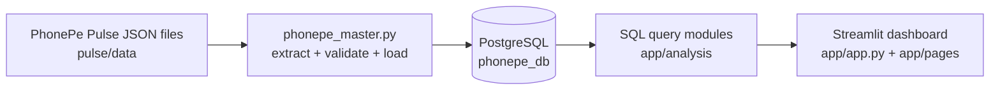

# PhonePe Pulse Dashboard

An end-to-end data project built on the open **PhonePe Pulse** dataset:

1. An **ETL script** reads the Pulse JSON files, validates them and loads them into **PostgreSQL**.
2. A **Streamlit dashboard** queries the database and shows transactions, users and merchants on an interactive India map.
3. Five **business case studies** analyse growth, engagement and expansion opportunities. Every finding on the pages is calculated from the data.

**Data covered:** 2018 Q1 to 2026 Q2 (34 quarters), 9 tables, 42,042 rows.

---

## Table of contents

1. [How it works](#how-it-works)
2. [Folder structure](#folder-structure)
3. [Quick start (step by step)](#quick-start-step-by-step)
4. [The ETL pipeline](#the-etl-pipeline)
5. [Database tables](#database-tables)
6. [Code and name mapping](#code-and-name-mapping)
7. [The dashboard and case studies](#the-dashboard-and-case-studies)
8. [Data limitations](#data-limitations)
9. [Troubleshooting](#troubleshooting)

---

## How it works



The project keeps three jobs apart so each is easy to understand and change:

| Job | Where it lives |
|---|---|
| Getting data into the database | `phonepe_master.py` |
| SQL queries | `app/analysis/queries.py`, `case_queries*.py` |
| Calculations and written findings | `app/analysis/case_logic*.py` |
| Screens and charts | `app/app.py`, `app/pages/` |

---

## Folder structure

```
phonepe_project/
│
├── phonepe_master.py          ETL: JSON -> validation -> PostgreSQL
├── requirements.txt           Python packages
├── README.md                  This file
├── .gitignore                 Keeps secrets and raw data out of Git
│
├── .streamlit/
│   └── config.toml            Dashboard colour theme
│
├── pulse/                     PhonePe Pulse data (you download this, not in Git)
│   └── data/
│       ├── aggregated/        Totals by country / state
│       ├── map/               State hover data
│       └── top/               Top states, districts, pin codes
│
└── app/
    ├── app.py                 Main dashboard page
    ├── .env                   Your database login (you create this, not in Git)
    ├── .env.example           Template for .env
    │
    ├── db/
    │   └── connection.py      Database connection and run_query() helper
    │
    ├── analysis/
    │   ├── queries.py         Queries for the main dashboard
    │   ├── case_queries.py    SQL for case studies 1 and 4
    │   ├── case_logic.py      Calculations and findings for cases 1 and 4
    │   ├── case_queries_5.py  SQL for case study 5
    │   ├── case_logic_5.py    Calculations and findings for case 5
    │   ├── case_queries_78.py SQL for case studies 7 and 8
    │   └── case_logic_78.py   Calculations and findings for cases 7 and 8
    │
    ├── maps/
    │   ├── india_states.geojson          Original state boundaries
    │   ├── india_states_merged.geojson   One shape per state (used by the map)
    │   └── merge_india_states.py         Builds the merged file
    │
    └── pages/                 Extra Streamlit pages (appear in the sidebar)
        ├── 1_Case_Studies.py        Cases 1 and 4
        ├── 2_Case_Studies_7_8.py    Cases 7 and 8
        └── 3_Case_Study_5.py        Case 5
```

---

## Quick start (step by step)

These steps work on a fresh computer. Commands are for **Windows PowerShell**; macOS/Linux alternatives are noted.

### What you need first

- **Python 3.10 or newer** ([python.org](https://www.python.org/downloads/))
- **PostgreSQL** with a user that can create a database ([postgresql.org](https://www.postgresql.org/download/))
- **Git** ([git-scm.com](https://git-scm.com/downloads))

### Step 1: Get the project

```powershell
git clone https://github.com/rangarajprml3188/phonepe-pulse-dashboard.git
cd phonepe-pulse-dashboard
```

### Step 2: Create and activate a virtual environment

```powershell
python -m venv .venv
.\.venv\Scripts\Activate.ps1
```

macOS/Linux: `source .venv/bin/activate`

If PowerShell blocks the script, run this once and activate again:

```powershell
Set-ExecutionPolicy -Scope Process -ExecutionPolicy RemoteSigned
```

Your prompt should now start with `(.venv)`.

### Step 3: Install the packages

```powershell
pip install -r requirements.txt
```

### Step 4: Download the PhonePe Pulse data

Run this **inside the project folder** so a `pulse/` folder appears next to `phonepe_master.py`:

```powershell
git clone https://github.com/PhonePe/pulse.git
```

The ETL expects the files at `pulse/data/`.

### Step 5: Create the database

The ETL creates the tables but not the database itself. In pgAdmin, or in `psql`, run:

```sql
CREATE DATABASE phonepe_db;
```

The ETL connects to `localhost:5432`, database `phonepe_db`, user `postgres`. If yours differ, edit the `DB = dict(...)` line near the top of `phonepe_master.py`.

### Step 6: Load the data (ETL)

First a safe test run. It extracts and validates but does **not** touch the database:

```powershell
python phonepe_master.py --test
```

Look for `ALL CHECKS PASSED`. Then do the real load:

```powershell
python phonepe_master.py
```

You will be asked for your PostgreSQL password. It is typed hidden and is never saved in the code. (You can also set the `PGPASSWORD` environment variable instead.) At the end you should see `ETL COMPLETE`.

### Step 7: Tell the dashboard how to connect

Copy the template and fill in your details:

```powershell
Copy-Item app\.env.example app\.env
```

Open `app/.env` and set:

```
DB_HOST=localhost
DB_PORT=5432
DB_NAME=phonepe_db
DB_USER=postgres
DB_PASSWORD=your_password_here
```

`.env` is listed in `.gitignore`, so your password is not uploaded to GitHub.

### Step 8: Run the dashboard

From the project root:

```powershell
streamlit run app/app.py
```

A browser tab opens (usually `http://localhost:8501`). The case study pages appear in the left sidebar.

### Optional: rebuild the map file

`app/maps/india_states_merged.geojson` is used by the map. If it is missing, rebuild it from the original:

```powershell
cd app\maps
python merge_india_states.py
cd ..\..
```

---

## The ETL pipeline

`phonepe_master.py` does four things in order:

| Step | What happens |
|---|---|
| **Extract** | One function per table walks the `pulse/data` folders, reads every JSON file and builds a pandas DataFrame. Year and quarter come from the folder and file names. |
| **Validate** | Row counts are compared with expected values, duplicate keys are checked, state spelling is compared between tables, and zero-filled columns are flagged. |
| **Load** | All nine tables are written to PostgreSQL in **one transaction**, so a failed load leaves the database unchanged. |
| **Verify** | Row counts are checked again inside PostgreSQL. |

Useful to know:

- `python phonepe_master.py --test` runs only extract and validate.
- State is stored in every table. **A `NULL` State means a country total**, so national numbers are never double counted.
- Re-running the script replaces the nine tables with fresh data.
- When PhonePe publishes new quarters, update the expected row counts at the top of the script, re-run it, then restart the dashboard so cached results refresh.

---

## Database tables

| Table | Rows | Main columns |
|---|---|---|
| `aggregated_transaction` | 3,773 | State, Transaction_type, Payment_instrument, Transaction_count, Transaction_amount, Year, Quarter |
| `aggregated_user` | 1,258 | State, Registered_users, Year, Quarter |
| `aggregated_merchant` | 1,212 | State, Registered_merchants, Year, Quarter |
| `map_transaction` | 1,224 | State, Transaction_count, Transaction_amount, Year, Quarter |
| `map_user` | 1,224 | State, Registered_users, Year, Quarter |
| `map_merchant` | 1,178 | State, Registered_users, Registered_merchants, Year, Quarter |
| `top_transaction` | 10,880 | State, District, Year, Quarter, Transaction_type, Transaction_count, Transaction_amount |
| `top_user` | 10,880 | State, District, Year, Quarter, User_type, Registered_users |
| `top_merchant` | 10,413 | State, District, Year, Quarter, Transaction_type, Transaction_count, Transaction_amount |

**How the folders become tables**

| JSON folder | Table(s) |
|---|---|
| `aggregated/transaction`, `/user`, `/merchant` | `aggregated_*` |
| `map/transaction/hover`, `/user/hover`, `/merchant/hover` | `map_*` (state level) |
| `top/transaction`, `/user`, `/merchant` | `top_*` |

Column names are mixed case, so in SQL they need double quotes, for example `SELECT "State" FROM map_transaction;`.

---

## Code and name mapping

State names appear in several places, and they are spelled slightly differently in each. This is the chain they pass through:

| Where | Example spelling | Rule |
|---|---|---|
| Pulse folder names | `tamil-nadu` | hyphens |
| Pulse JSON content | `tamil nadu` | spaces, lowercase |
| Database (after ETL) | `tamil nadu` | lowercase with spaces |
| Dashboard text | `Tamil Nadu` | converted to Title Case for display |
| GeoJSON map file | its own names | matched through a name-mapping dictionary in `app/app.py` |

The ETL turns folder hyphens into spaces and lowercases everything, so the database uses one spelling everywhere. The mapping dictionary in `app.py` links those database names to the names inside the GeoJSON so each state colours correctly. If a state does not colour, the app shows a warning that it could not be matched.

**Query pattern.** Every SQL function lives in a query module, takes plain arguments (state, year, quarter) and returns a pandas DataFrame through `run_query()`. Results are cached for an hour with `st.cache_data`.

**Calculation pattern.** Growth rates, segments and the written findings live in the `case_logic*.py` files. They use only pandas, so they can be tested without a database or Streamlit.

---

## The dashboard and case studies

**Main page (`app.py`):** state, year and quarter filters, an India map, and a state summary with transaction totals, category breakdown and top district.

**Case study pages** (open them from the sidebar):

| Page | Case | Question | Main measures |
|---|---|---|---|
| Case Studies | 1. Transaction dynamics | Where is usage growing, stagnating or declining? | Year-over-year growth, category mix, growth heatmap |
| Case Studies | 4. Market expansion | Which states to activate or expand into? | Transactions per user, average ticket size, four segments |
| Case Studies | 5. User engagement and growth | How engaged are users, and where to grow? | Transactions per registered user, growth versus engagement quadrant |
| Case Studies | 7. Transactions across states and districts | Which states and districts lead? | Count and value shares, top districts |
| Case Studies | 8. User registrations | Where are users and new sign-ups concentrated? | Registered users, net new users, top districts |

Each page ends with a **Findings** list that is written from the live data for the year and quarter you select.

---

## Data limitations

Read these before drawing conclusions. They come from the source files, not from the code.

- **Value exists only at state level.** The aggregated and top transaction files contain counts but no amounts, so category and district analysis uses transaction **counts**. Payment value comes from `map_transaction`.
- **No app-open counts.** Case 5 therefore measures engagement as transactions per registered user.
- **No device or insurance data** is present in this dataset, so the device and insurance case studies are not included.
- **Registered users is cumulative** (a running total), while transactions are per quarter. Ratios such as transactions per user are good for comparing states and quarters, not as an absolute usage rate.
- **Top lists are partial.** PhonePe publishes only the top 10 districts per state, and pin codes are not loaded.

---

## Troubleshooting

| Problem | Likely cause and fix |
|---|---|
| `ImportError: cannot import name 'case_queries'` | A file is missing from `app/analysis/`. Check all six `case_*` files are there, then fully restart Streamlit (Ctrl+C, run again). |
| `DB_PASSWORD not set` | `app/.env` is missing or in the wrong folder. It must sit next to `app.py`. |
| `Could not connect to PostgreSQL` | PostgreSQL is not running, or the host, port, user or password is wrong. |
| `data folder not found` when running the ETL | The `pulse/` folder is not in the project root. Repeat step 4. |
| Charts empty after reloading the database | Cached results. Stop and restart Streamlit, or press `C` in the browser and choose Clear cache. |
| PowerShell says scripts are disabled | Run `Set-ExecutionPolicy -Scope Process -ExecutionPolicy RemoteSigned`, then activate again. |
| A state is grey on the map | Its name did not match the GeoJSON. The warning on the page names it, so add it to the mapping dictionary in `app/app.py`. |
| Pasting commands gives `Unexpected token 'PS'` | You copied the prompt. Copy only the command, not `(.venv) PS D:\...>`. |

---

## Data source

Transaction, user and merchant data from the open [PhonePe Pulse](https://github.com/PhonePe/pulse) repository.
